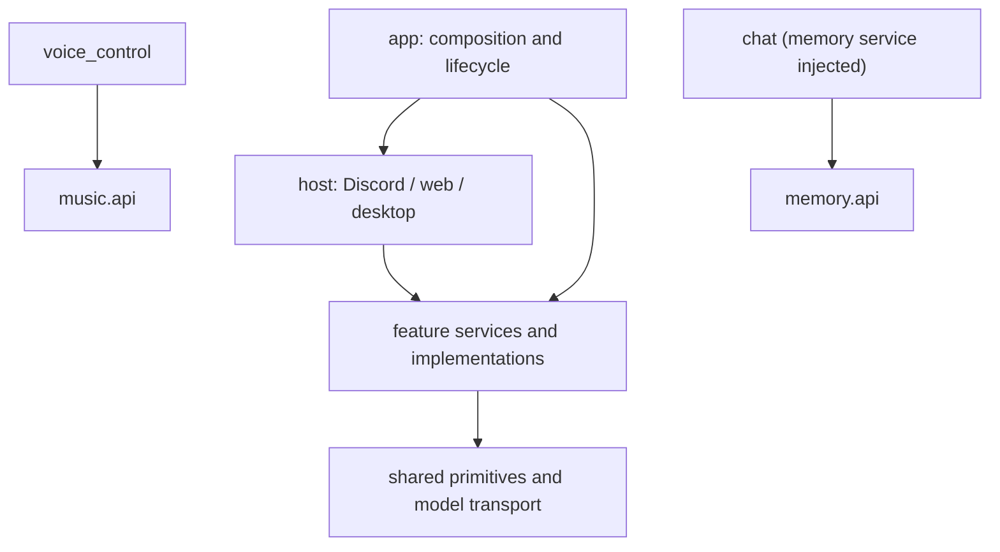

# Feature-first architecture

This document describes the implemented architecture. The application is one Python process
with multiple feature packages; these are not independently deployed services.

## Package ownership

```text
main.py                         stable launcher / compatibility import
bot/                            legacy public imports
bot_app/
  app/                          composition, configuration, application lifecycle
    main.py                     CLI, --check, process lock, API lifetime
    bootstrap.py                explicit factories and dependency wiring
    ai.py                       chat + memory + model resource ownership
    management.py               local administration facade
    configuration.py            JSON settings repository
    settings_catalog.py         feature schema registry
    settings.py                 application/restart status reports
  host/                         platform and process entry points
    discord/                    gateway bot and voice receive transport
    desktop/                    tray, process controller, file IPC client
    web/
      server.py                 loopback API, origin guard, route composition
      shell/                    navigation and shared administration shell
  features/
    music/                      playback, queue, personal libraries and search
      api.py                    supported interface for voice control
      service.py                one PlaybackService and its internal operations
      commands.py extras.py playback.py sessions.py recovery.py
      track.py models.py library_rules.py policies.py control.py errors.py
      settings.py ports.py      music-owned configuration and contracts
      adapters/                 Discord commands and player panels
      storage/                  atomic queue/library JSON and music files
      media/                    extraction, FFmpeg, cue mixing, embedded replies
    voice_control/
      grammar.py                wake/command parsing
      recognition.py            optional local ASR
      service.py                speaker sessions, cancellation and selection
      discord.py                commands and listeners
    welcome/                    templates, deduplication, delivery, settings
    polls/                      validation, Discord native polls, creator storage
    utilities/                  ping, sync, emoji, add
    updates/                    release validation, staged install, rollback
    voice_moderation/           existing stored-only settings, no engine
    chat/
      settings.py prompts.py    participation policy and versioned instructions
      service.py                channel scheduling, decisions, generation, send guards
      storage.py                decision and delivery SQLite records
      discord.py                transport and /chat commands
      http.py web/              group chat administration
    memory/
      settings.py prompts.py    extraction and retention policy
      api.py                    public scoped memory service/background worker
      storage.py                source/evidence/job/history/vector SQLite storage
      discord.py                /memory member commands
      http.py web/              inspection, approval, correction, forgetting, export
  shared/
    identity.py                 immutable Discord scope/member/message identities
    revisions.py redaction.py   small shared primitives
    llm/deepseek.py             HTTP, concurrency, budgets, usage/cache accounting
    paths.py logging_setup.py diagnostics.py
    runtime.py process_runtime.py security.py logs.py contracts.py
  application/ domain/ infrastructure/ presentation/
                                import compatibility shims only
scripts/                        supervisor, installers, release builder, local preview
tests/
  architecture/ desktop/ updates/ music/ management/
  voice_control/ welcome/ polls/ integration/
```

Small features keep their implementation together. Only music currently needs deeper internal
packages. Do not add parallel controller/service/repository directory trees across the project.
Add a public `api.py` when another feature needs supported operations, rather than exposing
session dictionaries or concrete storage.

## Dependencies



- `app` wires concrete dependencies. Host objects receive factories from composition.
- A feature must not import `app` or the legacy layer packages.
- Cross-feature imports use the destination feature's public API. Chat receives the memory
  service by injection; it does not construct memory storage or an embedding client.
- `shared` has no imports from `features`, `app` or `host`.
- Platform adapters live next to the feature they expose. Generic bot lifecycle, sockets,
  tray processes and HTTP shell routing belong to `host`.
- Feature tests enforce these dependency rules and compatibility aliases.

The retained legacy files redirect to the same module objects, not duplicate implementations.
Keep `bot_app.main`, old updater entry paths and `bot/*` available for installed launchers,
standalone rollback helpers and existing integrations. New implementation changes belong in
the canonical feature packages.

## Existing feature flows

### Music and voice

Discord command/panel or local management control → validation and authenticated actor
context → PlaybackService dispatch → guild session/control lock → queue/playback operation →
storage checkpoint and player/status update. Each guild has one player, one queue and one
voice connection. Moving the bot preserves that session.

Voice audio → bounded local segments → optional ASR → wake/command grammar → speaker session
and candidate matching → `music.api` → the same authenticated music dispatch. A model never
supplies a user's authority. Spoken cues go through music's mixer so pause position, volume,
ducking and cancellation remain owned by music.

All live music mutations stay on the bot event loop. Metadata/download work uses the existing
bounded executor; workers return values, not mutations of live sessions. Generation checks
reject late callbacks. Stop clears a session; idle/pause retirement preserves its queue.
See [Music maintenance](music-maintenance.md) and [Voice replies](voice-replies.md).

### Welcome, polls and utilities

Welcome member event → screening/deduplication → guild settings/template expansion →
permission-checked delivery and retry. Native polls retain Discord-owned votes/deadlines;
local storage records their creator for authorized early closing. Utility and update command
registration is owned by its feature, not embedded in the host bot class.

### Management and updates

Tray → atomic command files with command/instance IDs → bot-loop control consumer →
acknowledged result by ID. The tray can start an offline bot. The in-process HTTP dashboard
uses the same management facade and stops with the bot.

Owner update command → trusted GitHub release + checksum/manifest validation → staged
environment → queue checkpoint → standard-library supervisor replacement/restart →
ready acknowledgement or rollback. Old updater-required paths remain valid. Configuration,
credentials and data are excluded from release replacement.

Source targets use `branch:NAME` or a 7–40 character commit SHA. Resolve the branch/abbreviation
once, fetch the immutable commit archive and verify allowed application blobs against its Git
tree. The installed manifest records source kind/ref/full SHA without changing the base stable
version. This uses the same preparation, environment, supervisor and rollback path as releases.
Bare `!update` selects the stable release, even when replacing a source build at the same version.
Before code replacement, back up the three AI SQLite stores. A declared memory schema mismatch
blocks installation; rollback restores application code/environment and retains live data.

## Group chat flow

1. Discord adapter ignores DMs, bots/webhooks, empty messages and commands. Explicit channel
   allowlist, server switch and excluded member IDs decide admission.
2. Normalize an immutable event with guild/channel/member/message IDs, reply reference and
   timestamp. Names are display data. Explicit mentions/replies or configured leading aliases
   mark direct address.
3. Append to that channel's bounded context; optionally retain a source for memory. Each
   channel has one pending worker. Debounce combines bursts; maximum wait prevents starvation.
4. Apply quiet hours, autonomous cooldown and hourly/rolling-24-hour send quotas. Direct
   address bypasses autonomous timing, but has a per-member limit and the shared model budget.
5. Read lightweight scoped memory and ask the model for `reply / wait / skip`. Validate its
   reason and target against the exact supplied transcript. A direct address selects reply
   without a separate judge request.
6. Observe mode records decisions and creates memory candidates without generating/sending
   a reply. Participate mode recalls full memory, then generates a short natural response.
7. Recheck the channel sequence, chat/memory configuration revisions, memory invalidation
   epoch and live send permission. New messages, edits, deletion or forgetting cancel stale
   work. Empty, excessive and immediately duplicate replies are suppressed.
8. Reserve a durable delivery ID before sending. Success records the returned Discord ID.
   An ambiguous failure becomes `unknown` and is never blindly resent. Restart retires
   incomplete deliveries. A successful bot message joins context without triggering itself.

`wait` is reconsidered when new input arrives; it does not start a repeated model-call timer.
This initial implementation is text-only. AI conversation does not execute music commands,
tools, autonomous scheduled messages or cross-platform QQ/WeChat actions.

## Memory flow

Message source → bounded durable extraction batch → model JSON → transactional source revision
and attribution validation → fact/event/summary records + evidence. Each channel is isolated
by `discord:<guild-id>:<channel-id>`; subjects use stable member IDs.

- Short-term context is a channel deque. When memory is enabled, the first new event can
  restore recent retained context after restart. No Discord history scraping is performed.
- Durable facts describe self-reported information; episodes represent plans/events with
  attribution and optional explicit expiry. Batch summaries preserve who said what.
- Observe-mode or uncertain records are candidates and are excluded from recall until approved.
  Independent preferences coexist. Explicit exclusive corrections/rescheduling supersede the
  matching slot and invalidate old summaries; history retains the relationship.
- Recall combines lexical terms (including Chinese bigrams), a small member-profile boost
  and optional matching-model/dimension vectors. The current candidate scan is bounded to
  the latest 1,000 active records per channel. A recent summary may also be supplied.
- Embeddings use a separately configured OpenAI-format provider. Missing/failed embeddings
  fall back to keyword recall; a worker gradually indexes existing active records.
- Jobs have fingerprints, leases, bounded retry and source revisions. Edits/deletions or
  forgetting cannot be overwritten by an older extraction result.
- Source text expires on a per-server retention policy. Useful derived memory can remain
  with source IDs/timestamps after raw text expires. Completed job payloads are scrubbed.
- Corrections preserve superseded history; forgetting removes matching source and derived
  text/vectors, redacts related job payloads and invalidates pending responses. Metadata
  tombstones prevent replay from restoring deleted content.

The dashboard offers channel/member filtering, provenance links, candidate approval,
history inspection, corrections, per-record/member forgetting and scoped JSON export.
Members can list/correct/forget their own profile records in that channel using `/memory`.
A local administrator uses the loopback dashboard; this is the existing local trust boundary.
Extraction and participation remain model decisions and require real-world quality evaluation.

## DeepSeek caching and budgets

Judge and reply share an identical stable system/persona/scope prefix and individually
serialized historical messages. Time, retrieval results and task instructions are appended
at the end. History grows by appending until the configured count/character ceiling, then
rotates down to about 75% capacity to avoid discarding the oldest message on every input.

This makes prefix reuse possible; it does not promise a hit rate. DeepSeek manages cache
persistence/eviction and discovers common prefixes. Moving windows, edits, identity/persona
changes and cold caches reduce reuse. Cache is not durable bot memory. See the
[official caching guide](https://api-docs.deepseek.com/guides/kv_cache/).

The usage ledger reserves requests before network I/O, survives restart and groups judge +
reply into a shared per-channel daily family budget. Global request/token ceilings cover all
AI calls; extraction and embedding have their own channel budgets. Days use UTC; autonomous
send quotas use rolling hours/24 hours. Token limits conservatively count all input including
cached input. At most two model/embedding requests run concurrently. Network failures trigger
cooldown rather than unbounded retries.

Usage records distinguish model, stage, status, input/output tokens and reported cache hit/miss
tokens. Missing cache metrics remain unknown. The dashboard calculates hit rate by tokens over
reported requests. Monetary cost depends on provider/model/current peak pricing:
`cached input × cached rate + uncached input × uncached rate + output × output rate`.
No fixed price or assumed hit rate is embedded in scheduling.

## Configuration, persistence and lifetime

| Data | Location | Semantics |
|---|---|---|
| Credentials | local `.env` | never returned by the dashboard |
| Music/welcome/moderation | `config/guilds/<guild>/<section>.json` | independent legacy server snapshots |
| Chat/memory | same directory | only server differences stored; unspecified values inherit global defaults |
| Music/polls/library | existing `data/queues`, `data/polls`, `data/library` | existing formats retained |
| Chat decisions/deliveries | `data/chat/chat.sqlite3` | bounded decisions, send idempotency |
| Source/memory/evidence/jobs | `data/memory/memory.sqlite3` | WAL, schema metadata, per-channel scope |
| Model/cache usage | `data/ai/usage.sqlite3` | additive accounting migration, durable reservations |
| Runtime/tray IPC | `runtime/` | instance-bound atomic files |

Chat and memory default to disabled; observe is the initial participation mode. Changes apply
to new operations; generation rechecks prevent sending under stale policy. AI startup failure
is logged without taking existing bot features offline. A broken memory store allows current
short-term chat with empty recall; it is never silently replaced with an empty database.

One process owns the event loop, channel workers and per-feature SQLite executors. Shut down
chat workers, memory worker/database executor and model HTTP session explicitly. Do not run
multiple bot/API workers against the same data. Stop the bot before copying SQLite files,
or use SQLite's backup API; copying an active WAL main file alone is not a safe backup.

HTTP remains loopback by default. Writes require `X-Requested-With: BotDashboard` and a
same-origin Origin when supplied; there is no login or wildcard CORS. Do not expose the
unauthenticated local dashboard directly to a public network. Voice moderation remains
stored-only and does not claim runtime enforcement.

## Validation and rollout

Run `python -m unittest discover -s tests -v`. Suites cover canonical/compatibility imports,
commands, music/voice invariants, updater rollback/release completeness, configuration, local
HTTP, scoped memory, stale work, forgetting, model budgets and cache-prefix construction.
Tests use temporary data, mocks and loopback servers, not real Discord/model credentials.

Use `python scripts/preview_dashboard.py` for a disposable dashboard at
`http://127.0.0.1:8876/`; it has fake servers, temporary data and no model key.
See [AI chat and memory setup](ai-chat-memory.md) for opt-in rollout and remaining live checks.
